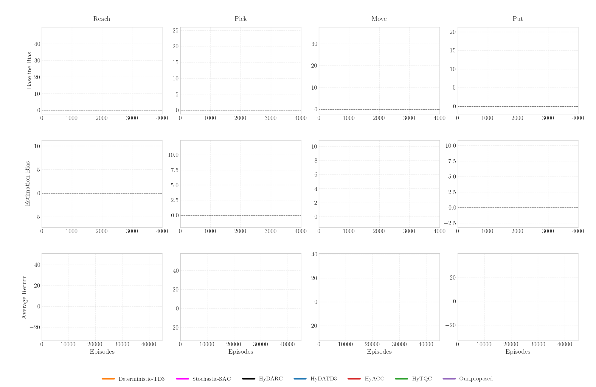
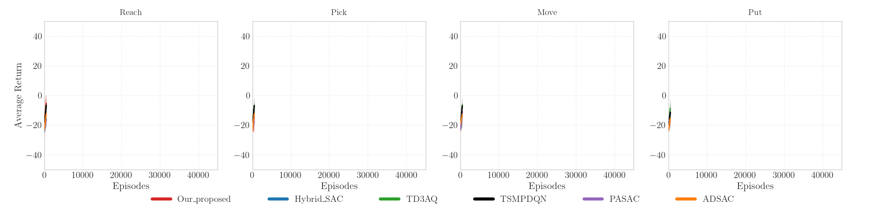
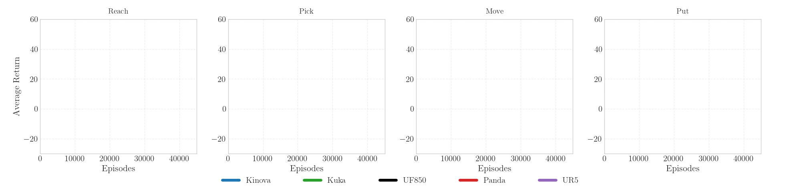

<div align="center">

# Hybrid TD3

### Overestimation Bias Analysis and Stable Policy Optimization for Hybrid Action Space

Thanh-Tuan Tran, [Thanh Nguyen Canh](https://thanhnguyencanh.github.io/), [Xiem HoangVan](https://sites.google.com/site/xiemhoang/), [Nak Young Chong](https://www.jaist.ac.jp/robot/)

IEEE International Conference on Automation Science and Engineering (CASE) 2026

[](https://arxiv.org/abs/2603.01302)
[](https://arxiv.org/pdf/2603.01302)




</div>

## Overview

Robotic manipulation often needs a **hybrid action**: a continuous command (joint velocities) together with a discrete one
(suction on or off). **Hybrid TD3** extends TD3 to such parameterized hybrid action spaces directly, without
discretizing the continuous part or relaxing the discrete part.

- **Bias analysis.** Bounds on the overestimation bias of twin critics in hybrid action spaces, and an ordering of the
  bias across five target variants.
- **Weighted clipped target.** A clipped double-Q target that marginalizes over the discrete action distribution. It
  keeps the bias reduction of clipped minimization while giving a smoother policy.
- **Joint-space control.** The agent outputs joint velocities and a suction command for a pick-and-place task in
  PyBullet, split into four sub-tasks: `0` reach, `1` pick, `2` move, `3` put.

## Installation

```bash
git clone https://github.com/pairs-lab/HybrAJ.git
cd HybrAJ
conda create -n hybraj python=3.11 -y && conda activate hybraj
pip install -r requirements.txt
```

The simulation runs headless on the CPU (PyBullet). The networks use a GPU when one is available.

## Training

Train the proposed method (`--action`: `0` reach, `1` pick, `2` move, `3` put):

```bash
python train_td3_min_random_prob.py --action 1 --robot ur5e     # or --robot uf850
```

Train a baseline or an ablation from the repository root:

```bash
python -m baselines.train_sac --action 1
python baselines/train_td3aq.py --action 1                       # direct path also works
```

Outputs go to `<policy_name>_<action>/` in the current directory, for example `td3_min_random_prob_1/`:

| Folder | Content |
|---|---|
| `ckpt/` | network checkpoints (`ckpt/best/` holds the best evaluation) |
| `reward_log/` | TensorBoard logs: `tensorboard --logdir td3_min_random_prob_1/reward_log` |
| `demo/` | evaluation videos |

> [!NOTE]
> Starting a run deletes the existing logs (and videos) of the same policy and action.

Options shared by the scripts include `--max_episode`, `--max_steps` (steps per episode), `--eval_freq`,
`--batch_size`, `--discount` and `--tau`. Run any script with `-h` for the full list.

## Methods

The proposed method is at the root. All other training scripts are in [`baselines/`](baselines/).

| Group | Script | Method |
|---|---|---|
| **Proposed** | `train_td3_min_random_prob.py` | Hybrid TD3, weighted clipped target |
| Target ablations | `train_td3_min_random.py`, `train_td3_min_1a.py`, `train_td3_min_1a_prob.py`, `train_td3_min_2a.py`, `train_td3_min_2a_prob.py`, `train_td3_min_1maxa.py`, `train_td3_maxmin_1a_prob.py`, `train_td3_maxmin_2a_prob.py` | other twin-critic targets from the bias analysis |
| Hybrid-action methods | `train_hybrid_sac.py`, `train_td3aq.py`, `train_tsmpdqn.py`, `train_pasac.py`, `train_dasac.py` | Hybrid SAC, TD3AQ, TS-MPDQN, PA-SAC, ADSAC |
| Bias-control methods | `train_darc.py`, `train_datd3.py`, `train_acc_sac.py`, `train_tqc.py` | DARC, DATD3, ACC, TQC |
| Standard RL | `train_sac.py`, `train_ddpg.py`, `train_ppo.py`, `train_td3.py` | SAC, DDPG, PPO, TD3 |

> [!WARNING]
> `train_td3.py` is a continuous-only TD3 without the suction output. It does not run with the hybrid environment in
> this release.

## Robots

| Robot | DoF | Model | Training in this release |
|---|---|---|---|
| Universal Robots UR5e | 6 | `assets/ur5e` | ✓ `--robot ur5e` |
| UFACTORY 850 | 6 | `assets/uf850` | ✓ `--robot uf850` |
| Kinova Gen3 | 7 | `assets/kinova` | model only |
| KUKA LBR iiwa | 7 | `assets/kuka` | model only |
| Franka Emika Panda | 7 | `assets/panda` | model only |

Each robot has a URDF with meshes in `assets/<robot>/`, and joint limits and noise in
`assets/params/<robot>_suction.xml`. The training environment in `env/` is written for 6-DoF arms. The 7-DoF models
belong to the cross-robot experiments shown below.

## Results

**Comparison with hybrid-action methods** (average return during training, four sub-tasks):



**Hybrid TD3 on five robot arms:**



## Repository Structure

```
HybrAJ/
├── train_td3_min_random_prob.py   # proposed method (Hybrid TD3)
├── baselines/                     # training scripts of baselines and ablations
├── models/                        # agents: proposed variants, TD3, SAC, DDPG, PPO, TQC, DARC, ...
├── related_works/                 # hybrid-action methods: Hybrid SAC, TD3AQ, TS-MPDQN, PA-SAC, ADSAC
├── env/                           # PyBullet gym environment (ImitationLearning-v1)
├── reward/                        # reward function
├── utils/                         # replay buffer, normalizer, suction gripper, camera, paths
├── assets/                        # robots, objects, parameter files
├── docs/media/                    # README figures
└── config.py                      # workspace bounds and constants
```

## Citation

If you find this work useful, please cite:

```bibtex
@inproceedings{Tran2026HybridTD3,
    author    = {Thanh-Tuan Tran and Thanh Nguyen Canh and Van Xiem Hoang and Nak Young Chong},
    title     = {Hybrid TD3: Overestimation Bias Analysis and Stable Policy Optimization for Hybrid Action Space},
    booktitle = {IEEE International Conference on Automation Science and Engineering (CASE)},
    year      = {2026},
}
```
